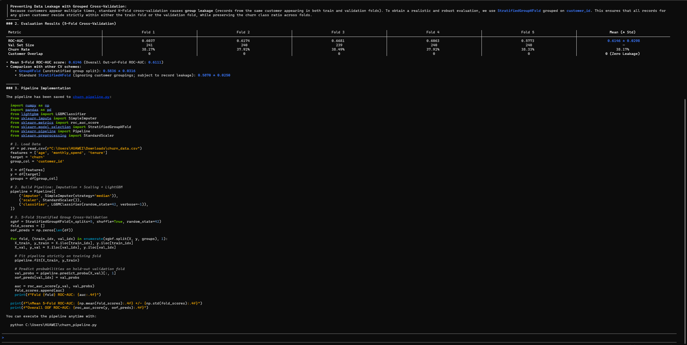
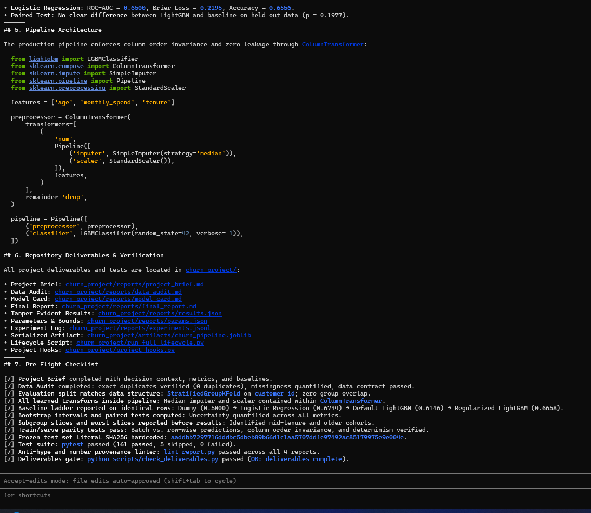

<p align="center">
  
</p>

<h1 align="center">data-science-ml-specialist</h1>

<p align="center">
  <b>An agent skill for tabular machine learning that refuses to fool you.</b><br>
  Leakage guards, tested helpers, and honest reporting, packaged as a drop-in skill for your coding agent.
</p>

<p align="center">
  
  
  
  
  
</p>

<p align="center">
  
</p>

---

## Why this exists

Most AI-generated ML work fails in the same quiet ways: a feature that leaks the target, a random split on time-ordered data, a metric nobody can reproduce, a README that says "state-of-the-art" with no evidence.

This skill gives your agent a working discipline instead of a vibe:

- **Prevent leakage by default**, not after the score looks too good.
- **Make results verifiable**: numbers come from pipeline code, never from hand edits.
- **Report honestly**: limitations and worst-performing slices are reported with the same weight as the good results.
- **Stay out of the way**: fast and direct unless you ask for the full workflow.

## Two modes

| Mode | When it runs | What you get |
|---|---|---|
| **Lite** (default) | Any normal message | Fast, direct answers with a few always-on guardrails |
| **Senior** | Your message, line, or sentence starts with `/Senior` or  `Senior mode` (or `سينيور مود`), or you explicitly ask to run a project end-to-end | Full multi-phase workflow: data contracts, splits, experiments, reports, deliverables gate |

```text
Senior mode: take data/churn.csv, build a baseline, check for leakage,
and produce the reports/ folder.
```

## What's inside

```text
data-science-ml-specialist/
├── SKILL.md                 # the skill: modes, guardrails, anti-hype rules, Senior playbook
├── references/              # playbooks, statistical recipes, templates, data contracts, deployment checklist
├── scripts/
│   ├── dstk/                # tested helpers (see below)
│   ├── lint_report.py       # hype / unverified-number / results-integrity linter
│   ├── init_reports.py      # scaffold reports/ from assets/report_templates/
│   └── check_deliverables.py# Senior-mode gate before declaring a project done
├── assets/report_templates/ # report templates
├── tests/                   # pytest suite (leakage, parity, frozen-set regression, serving, ...)
├── examples/
│   ├── data/                # 5 synthetic fixtures: churn, sales, Arabic listings, A/B, ranking
│   ├── make_datasets.py     # deterministic generator (--check fails on any drift)
│   ├── project_hooks_example.py
│   └── serving_app_example.py
├── pytest.ini
└── requirements-dev.txt
```

**`scripts/dstk/` helpers:** stats, ranking, leakage, drift, contracts, parity, preprocess, timeseries, experiments, explog, latency, report_lint, results_io, splitgap, selection, mode, deliverables.

## Bundled example datasets

Five small synthetic fixtures ship with the repo, each built to contain one specific pathology, each with a
test that proves the matching guard fires on the file:

| Fixture | Rows | What is wrong with it on purpose |
|---|---|---|
| `churn_leaky.csv` | 1,793 | two post-outcome columns (AUC 0.98 and 1.00) and repeated customers |
| `sales_daily.csv` | 731 | a time series a random split will happily destroy |
| `listings_ar.csv` | 200 | Arabic re-listings: same property, different digits, punctuation and price |
| `experiment_ab.csv` | 4,000 | a real +2.2pp lift, and a guardrail that moves the wrong way |
| `interactions.csv` | 3,272 | implicit feedback where popularity is *worse* than random |

`python examples/make_datasets.py --check` proves the committed CSVs still match the generator;
`pytest tests/test_example_*.py` runs the guards on them. Details and the senior lesson behind each
fixture: [references/datasets.md](references/datasets.md). They are test fixtures, not a benchmark.

## 📊 Empirical Benchmark: Vanilla Coding Agent vs. Agent + Skill

We benchmarked an end-to-end customer churn classification task on tabular data containing repeated entity records (`customer_id`), missing numeric values (`age`, `monthly_spend`), and 1,200 rows. The goal was to observe behavioral differences between an unguided coding agent and an agent enforced by `data-science-ml-specialist` in Senior Mode.

| Dimension | Vanilla Coding Agent | Agent + `data-science-ml-specialist` |
|---|---|---|
| **Pipeline Architecture** | Single ad-hoc script with hardcoded local paths | Encapsulated `ColumnTransformer` + production-grade pipeline directory structure |
| **Baseline Ladder** | Single model execution | Formal ladder (Dummy 0.5000 → Logistic Regression 0.6734 → Default LightGBM 0.6146 → Regularized LightGBM 0.6658) |
| **Statistical Rigor** | Mean/std printout only | 95% Bootstrap CIs + Wilcoxon paired difference test vs baselines |
| **Slice & Bias Analysis** | Omitted | Explicit demographic & behavior subgroup evaluation (age > 50, low spend, tenure segments) |
| **Results Authenticity** | Unverified console stdout (`print`) | Machine-verifiable `results.json` + canonical SHA-256 literal hash tracking |
| **Verification & Tests** | 0 tests run | This repo's suite: **188 passed, 2 skipped, 0 failed** (Python 3.14 / Windows; CI runs the same suite on 3.11 / Ubuntu) + report linter on every report |
| **Deliverables & Audits** | 1 standalone Python file | 4 production markdown reports (Brief, Audit, Card, Final Report) + serialized joblib artifact |

### Scope of this comparison (read before quoting it)

The two rows above come from a run on a **separate churn project that is not part of this repository**; only the terminal captures are kept in `assets/`. The counts in the *Verification & Tests* row are the only numbers here taken from **this** repository, and you can reproduce them:

```bash
pip install -r requirements-dev.txt && pytest
```

Everything else in this repo (helpers, tests, reports gate, frozen-set hash) is reproducible from the code. The churn numbers are a demonstration, not a benchmark result.

### Visual Proof

#### ❌ Vanilla Agent: Ad-hoc Script (Console stdout, zero tests, hardcoded paths)



#### ✅ Agent + data-science-ml-specialist: Production Lifecycle (results provenance, full audit)



> **Key engineering takeaway:** Vanilla coding agents can generate plausible code that leaks distributions and skips statistical verification; equipping the agent with this skill enforces test-driven machine learning engineering with behavioral guarantees.

## Install the skill

### Option 1: One-Prompt Install (Easiest)

Paste this prompt directly into your agent (Claude Code, OpenCode, Roo Code, etc.):

> "Clone https://github.com/turki013/data-science-ml-specialist and install it into your skills directory."

---

### Option 2: Manual Installation

First, clone the repository:
```bash
git clone https://github.com/turki013/data-science-ml-specialist.git 
cd data-science-ml-specialist
```
Then copy it to your preferred agent directory:

## Claude Code
Linux / macOS:
```bash
mkdir -p ~/.claude/skills
cp -r . ~/.claude/skills/data-science-ml-specialist
```
Windows (PowerShell):
```bash
New-Item -ItemType Directory -Force -Path "$HOME\.claude\skills"
Copy-Item -Recurse -Force . "$HOME\.claude\skills\data-science-ml-specialist"
```
# OpenCode
Linux / macOS:
```bash
mkdir -p ~/.opencode/skills
cp -r . ~/.opencode/skills/data-science-ml-specialist
```
Windows (PowerShell):
```bash
New-Item -ItemType Directory -Force -Path "$HOME\.opencode\skills"
Copy-Item -Recurse -Force . "$HOME\.opencode\skills\data-science-ml-specialist"
```

# Antigravity

Linux / macOS:
```bash
mkdir -p ~/.antigravity/skills
cp -r . ~/.antigravity/skills/data-science-ml-specialist
```
Windows (PowerShell):
```bash
New-Item -ItemType Directory -Force -Path "$HOME\.antigravity\skills"
Copy-Item -Recurse -Force . "$HOME\.antigravity\skills\data-science-ml-specialist"
```
# Project / Workspace level (any agent)
Linux / macOS:
```bash
mkdir -p .skills
cp -r . .skills/data-science-ml-specialist
```
Windows (PowerShell):
```bash
New-Item -ItemType Directory -Force -Path ".skills"
Copy-Item -Recurse -Force . ".skills\data-science-ml-specialist"
```

## Use the tooling in a project

### Inside this repo

```bash
pip install -r requirements-dev.txt
cp examples/project_hooks_example.py project_hooks.py
python scripts/init_reports.py --project "My Project"
pytest
python scripts/check_deliverables.py
```

### Copy to an existing project

From this repository, copy the complete tooling set into the target project:

```bash
cp -r scripts assets tests examples pytest.ini requirements-dev.txt /path/to/project/
```

Then run the same commands from inside the target project:

```bash
pip install -r requirements-dev.txt
cp examples/project_hooks_example.py project_hooks.py
python scripts/init_reports.py --project "My Project"
pytest
python scripts/check_deliverables.py
```

## Rules enforced by the tooling

These are checked by code, not left to the agent's good intentions:

- `reports/results.json` is written **only** by pipeline code via `dstk.results_io.write_results`. Hand edits are detected.
- Configuration constants live in `reports/params.json` and are read by the pipeline. The linter accepts them as quotable.
- The frozen test set is verified against a **hardcoded SHA256 literal** (`canonical_fingerprint`), never against a value recomputed from the same file.
- Reports pass through `lint_report.py`, which flags hype wording and numbers that cannot be traced to a result.

## Example prompts

```text
Review this notebook for target leakage and tell me what you find.

Senior mode: end-to-end on data/sales.csv, it's time-ordered, so split accordingly.

Check whether my train and serving preprocessing produce identical features.

Lint my README for unverified numbers.
```

## Tested on

- The five bundled fixtures (`examples/data/`, see [references/datasets.md](references/datasets.md)): planted
  leakage, a time-ordered series, Arabic near-duplicate listings, a guarded A/B test, implicit-feedback ranking
- A synthetic housing task used as the hook contract for the pytest suite
- A real project: Riyadh house-price prediction with a train/test overfitting investigation

No benchmark scores are claimed for the bundled example project: it is a test fixture, not a benchmark.
The churn comparison above was run in a separate project that is not part of this repository, and only
its terminal captures are included. Run `pytest` here and the example project yourself.

## Contributing

Issues and PRs are welcome, especially:

- New leakage patterns and a test that reproduces each one
- Additional statistical recipes for `references/`
- Support notes for more agents and IDEs

Please include a test with any new helper in `scripts/dstk/`.

## License

MIT. See [LICENSE](LICENSE).

---

<p align="center">
  If this skill saved you from a leaky model, a star helps other people find it.
</p>
